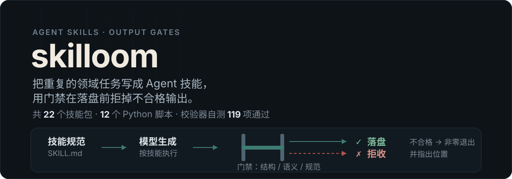

<a id="top"></a>

<p align="center">
  
</p>

<p align="center">
  <b>中文</b>
</p>

**把重复的垂直领域任务写成 Agent 技能，再用 Python 门禁在输出落盘前把它拦住。**

22 个技能包 + 12 个 Python 脚本（门禁、校验、同步，共 4881 行）。技能负责"该怎么做"，脚本负责"没做到就不许留下"。

---

## 为什么需要门禁

大模型生成内容的典型失败方式不是报错，而是**看起来完全正常、结构已经坏了**：标题层级被并列枚举撑成一串同级标题、Mermaid 流程图的节点连到不存在的分支、表格被拆散后丢了合并关系、题目解析里的答案依据被改写成结论。这类问题人工逐篇检查不可持续，等到导入笔记软件或发布出去才发现，返工成本更高。

所以本仓库把约束拆成两半：

- **`skills/`** —— 写给 Agent 读的操作规范（模式路由、判据、完成标准）。
- **`scripts/`** —— 写给机器执行的验收：解析产物、判定结构、命中即非零退出并指出位置。

不合格的输出被拒绝，而不是静默上线。

## 怎么跑

```bash
# 法律技能契约校验
python3 scripts/validate_legal_skills.py
# PASS legal contracts (generic validation skipped; set SKILL_CREATOR_QUICK_VALIDATE to enable it).

# 四道内容门禁（对当前仓库内容均为退出码 0）
python3 scripts/legal_goldquest_option_gate.py
python3 scripts/legal_goldquest_semantic_structure_gate.py
python3 scripts/legal_marknote_prose_gate.py
python3 scripts/legal_mermaid_semantics_gate.py

# 校验器自测（119 项 + 17 子测试，0.61s）
uv run --with pytest python3 -m pytest scripts/test_legal_note_output_validator.py -q
```

`audit_mermaid_semantics.py` 需要传入目录参数，用于批量审计某个笔记目录里的 Mermaid 语义。

> ⚠️ `scripts/gate_legal_skills.py`（聚合入口）**当前故意以退出码 2 结束**，见「已知限制」第 1 条。不要把它的非零退出误读成"仓库坏了"。

## 仓库构成

| 路径 | 内容 |
| --- | --- |
| `skills/<name>/SKILL.md` | 技能主体：frontmatter 的 `name` / `description` 决定何时被加载 |
| `skills/<name>/references/` | 按需加载的细则、词典、判据表 |
| `skills/<name>/scripts/` | 该技能自带的执行与校验脚本 |
| `skills/<name>/agents/` | 面向其他 Agent 运行时的适配清单（YAML） |
| `scripts/` | 仓库级门禁、校验器、自测与安装同步脚本 |

## 技能清单（22）

**法律学习（7）**

| 技能 | 做什么 |
| --- | --- |
| `legal-marknote` | 法考教材与笔记 → 结构化思源 Markdown；表格一律转成选轴父子列表，修复误识别标题与层级 |
| `legal-goldquest` | 题目、选项与完整解析 → 闪卡复习用结构化 Markdown，答案区语义颜色保持一致 |
| `legal-flashcard` | 生成 DAMO 兼容闪卡（两种显式模式），并经真实 Protyle 粘贴批量回灌思源 |
| `legal-question-bank` | 客观题/主观题 → 题库源文件，写入稳定的 `custom-qb-*` IAL 元数据供多端消费 |
| `legal-question-author` | 按题库错题、收藏与薄弱考点批量出卷、生成变式题成稿 |
| `legal-topic-linker` | 审计并修复题目与考点笔记之间的点对点链接 |
| `legal-imagen` | 为法律学习资料生成结构化配图提示词（时间线、流程、对比、情境） |

**资料管线（1）**

| 技能 | 做什么 |
| --- | --- |
| `fakao-mineru-merge` | 把分段/分册的 MinerU 解析产物合并成单一 `full.md` + `images/` + `目录.md` |

**题库插件与知识站点（4）**

| 技能 | 做什么 |
| --- | --- |
| `damophus-dev` | 开发 Damophus 思源题库插件：规划、实现、调试、测试、打包、提交 |
| `inkloom-dev` | 维护 InkLoom 法律学习站点，从已完成笔记产出独立 Remotion 讲解动画 |
| `produce-inkloom-animation` | 以主线程为唯一协调者与独立审查方，组织动画生产与修复 |
| `inkloom-embed` | 把已发布动画（AVIF）嵌入法考笔记、真金题与闪卡，并审计死链 |

**思源笔记工具（4）**

| 技能 | 做什么 |
| --- | --- |
| `siyuan-export` | `.sy` 文档/目录/工作区 ↔ Markdown 的双向导出导入（可配 IAL） |
| `siyuan-database-management` | 无幽灵行、无重复行地管理、查询、更新思源属性视图（AV/数据库） |
| `siyuan-linker` | 发现、审计、预览、创建并验证笔记与块之间的语义链接 |
| `siyuan-bazaar-release` | 通过 GitHub Releases 与思源社区市场索引发布和更新插件 |

**出图与偏好训练（3）**

| 技能 | 做什么 |
| --- | --- |
| `civitai-lora-install` | 查找、校验、下载并安装 Civitai LoRA，回填触发词与预览图 |
| `civitai-lora-upload` | 用已登录 Chrome + 本地文件桥批量上传 LoRA 作品 |
| `clipm-preference-training` | 通过 MCP / `xclipm` CLI 读写漫画面部偏好评分与人工校正 |

**Agent 基建与其他（3）**

| 技能 | 做什么 |
| --- | --- |
| `mcp-discovery` | 先定位 `~/.mcp.json` 里的既有 MCP 服务表，再考虑新增配置 |
| `session-nudge` | 向持久化 Agent 会话注入一条消息，让中断任务继续跑 |
| `trename` | ACG 资源归档：中英日动态翻译 + 文件系统命名规范批量重命名 |

## 一个技能包长什么样

```markdown
---
name: legal-flashcard
description: 一句话说明「做什么」+「什么时候该被加载」，供 Agent 判定触发。
---

正文按「模式路由 → 各模式步骤 → 完成标准」组织。
每条判据都写成可判定的句子，而不是建议。
```

约定：`description` 决定技能是否被载入，因此必须包含触发场景；正文里的每条规则都要能被脚本或人**判真伪**，"尽量""最好"这类词不算判据。

## 已知限制

1. **聚合门禁 `gate_legal_skills.py` 故意退出码 2。** 它现在是一道防误用守卫：`skills/legal-goldquest` 与 `skills/legal-marknote` 各自的 `validate_output.py` 已经分叉（goldquest 拆分 + E 系列门禁），继续从 `scripts/legal_note_output_validator.py` 这份旧副本覆盖会静默删掉两边的规则，所以同步路径被停用。部署技能文件请改用 `scripts/sync_installed_skills.py`。
2. **`scripts/legal_note_output_validator.py` 与技能内的 `validate_output.py` 不再是同一份代码**，前者是仓库级校验器与自测对象，后者按技能需要各自演进。
3. **本仓库不是全量技能库。** 含成人内容的技能包已移出（`9b0966b`），另有若干小说写作类技能仅存在于本地、被 `.gitignore` 排除。清单以上面的 22 个为准。
4. **技能是给 Agent 读的指令文本，不是可安装的软件包**：没有 `pyproject.toml`、没有依赖声明、没有版本发布流程。
5. **多数技能依赖本地环境**，在别人机器上不可复现：思源内核 API（`127.0.0.1:6806`）、ComfyUI 与 Civitai 登录态、Xiranite 的 ClipM 节点、ZCode 会话台账。
6. **考点 tag 词汇表与法考内容是个人学习资料的衍生物**，其准确性不构成法律意见。

## 许可

MIT —— 见 [LICENSE](./LICENSE)。

<p align="right"><a href="#top">回到顶部 ↑</a></p>
